# PadNote


**Put your thinking on the page. Work through it with AI. Hand the next task to your computer.**

PadNote is an open-source AI notebook for tablets. Read a document, write out a derivation, draw the connections, and discuss them on the same page. Share your work as a PDF, or send the note and its context to a paired computer Agent on your network to continue the task. Review the completed text result before adding it back to a note. You choose the model and service.

## Start with a real handwritten question

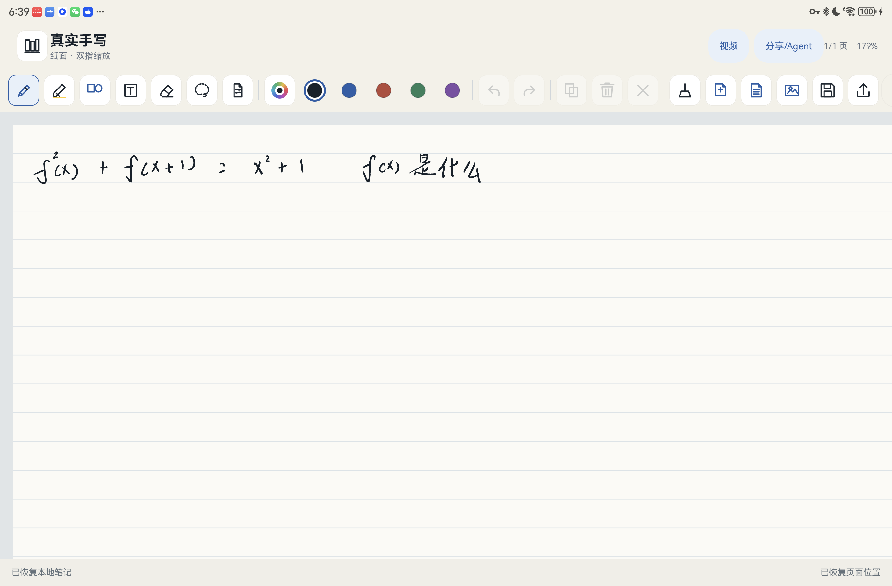

Write a question on the tablet and continue the discussion on the same page. When you need a plot or code, send the page and instructions to your computer Agent. This screenshot preserves the author's original handwriting and is shared with permission. [Media provenance](docs/media/2026-10-31/README.md).

[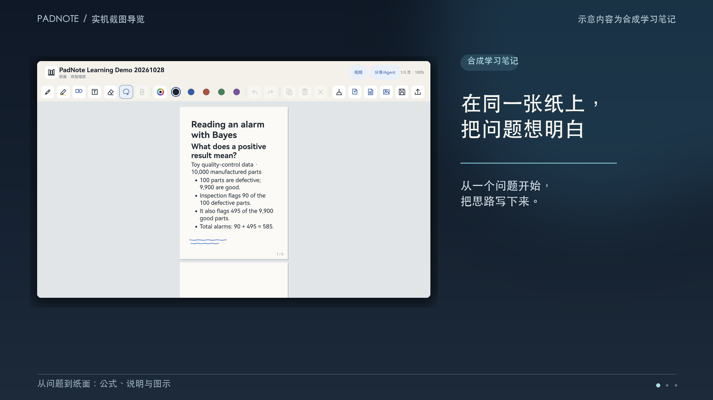](https://github.com/shiyan688/padnote/releases/download/v0.18.0-beta.24/PadNote-Learning-Tour-20261028.mp4)

[Watch the learning-note tour (30 sec)](https://github.com/shiyan688/padnote/releases/download/v0.18.0-beta.24/PadNote-Learning-Tour-20261028.mp4) · [Download the app and computer assistant](https://github.com/shiyan688/padnote/releases) · [中文](README.md)

The demos use synthetic learning content and real-device screenshots to show the page and sharing experience. They do not record AI or computer-Agent execution. [Media provenance](docs/media/2026-10-28/README.md).

| Step | What you do in PadNote | What you get |
| --- | --- | --- |
| 1. Learn and organize | Read, handwrite, draw, and discuss with your chosen model on the tablet page | Notes and ideas stay together on the page |
| 2. Share the page | Export the current note as a PDF, then share it through the system share sheet | Recipients can read the page layout |
| 3. Hand work to a computer Agent | Send page material to a paired Hermes Agent on the same network that supports note tasks | Track progress in the computer task list; review the result and add it back to a note when complete |

[Downloads and installers (GitHub Releases)](https://github.com/shiyan688/padnote/releases) · [Adding task results to a note](BETA34_TESTING.md) · [PDF sharing guide](docs/BETA25_TESTING.md) · [Text editing and drafts](docs/BETA26_TESTING.md) · [Removing and restoring notes](docs/BETA27_TESTING.md) · [Interface and workflow guide](docs/BETA28_TESTING.md) · [WSL tasks and connection setup](BETA32_TESTING.md) · [Selections and gestures](docs/AI_PAPER_SELECTION.md) · [Windows connection assistant notes](desktop/connection-assistant/windows-setup/README-WINDOWS.md) · [Build from source](#build-from-source) · [Report an issue](https://github.com/shiyan688/padnote/issues)


## Start with a sample

Choose **Open sample note** on the bookshelf to try writing, selection, and sharing. When you want to hand work to a computer, follow the assistant through checks, pairing, approval, and the first task. Brief annotations, full derivations, and review cards are editable instructions. [Steps and details](BETA35_TESTING.md).

<details>
<summary>See the sample and connection guide</summary>

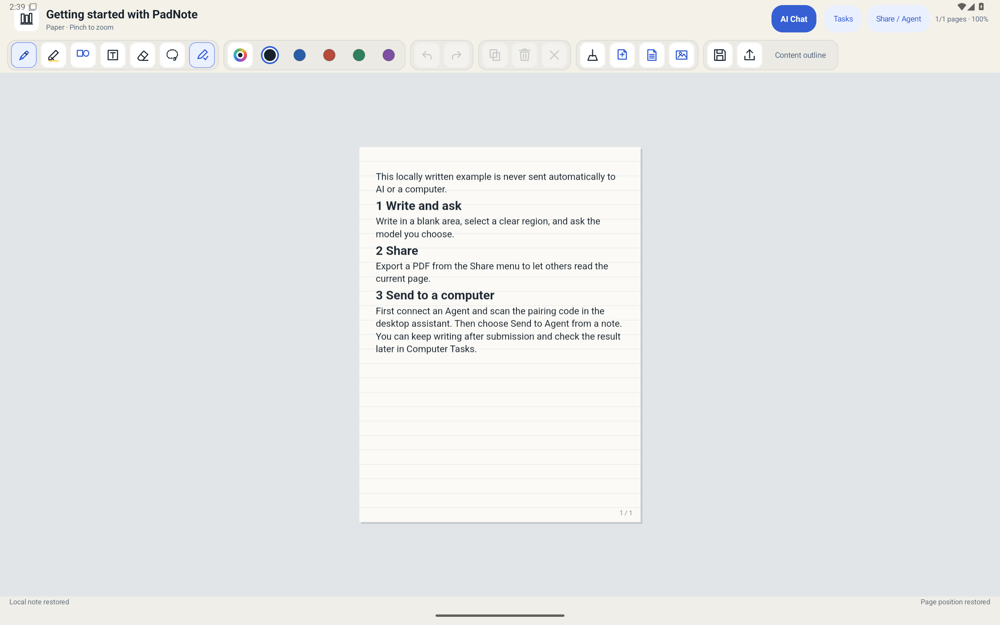

Desktop interface example with synthetic service state.

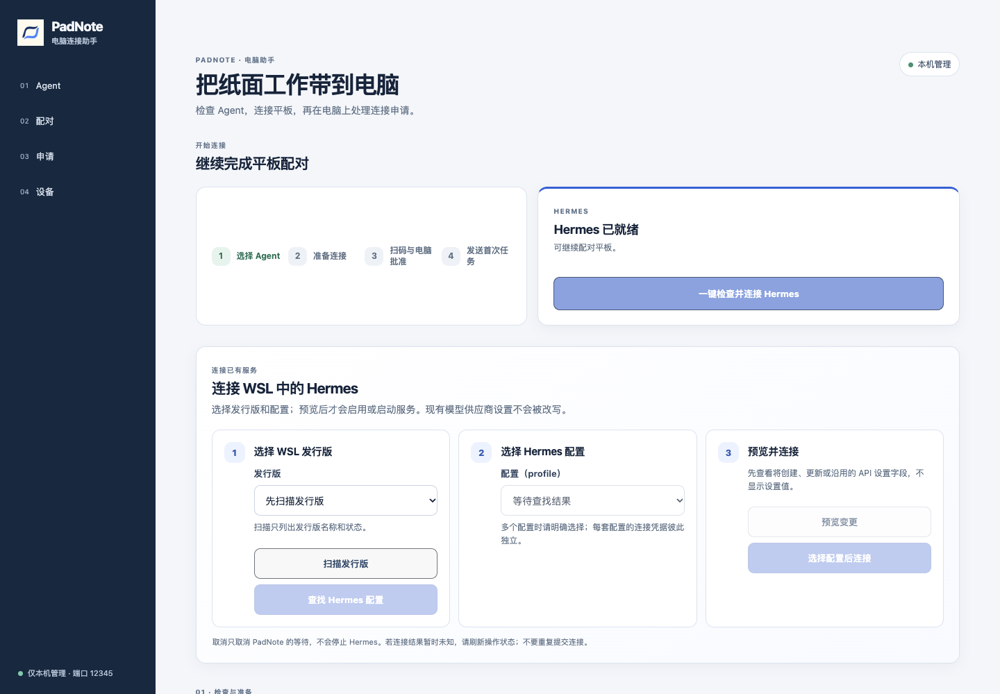

[Media notes](docs/media/2026-10-31/README.md).

</details>

## Computer connection guide

Keep writing after you send. Use “View progress” at the top to return to this task anytime. If receipt is unclear, tap “Check whether the computer received it” in the details to keep tracking the same task—no need to prepare the materials again. The Connection Assistant explains WSL or Hermes configuration issues in place and provides retry and installation guidance.

[Watch the computer connection guide (about 37 sec)](https://github.com/shiyan688/padnote/releases/download/v0.18.0-beta.33/PadNote-Connection-Guide.webm)

[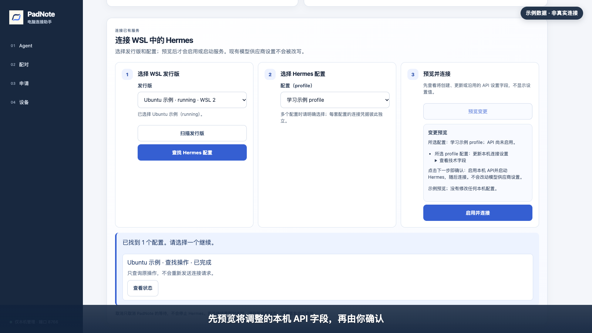](https://github.com/shiyan688/padnote/releases/download/v0.18.0-beta.33/PadNote-Connection-Guide.webm)

Synthetic interface and example state. See the [media provenance and scope](docs/media/2026-10-29/README.md).

## Bring task results onto the page

Preview completed text on the actual note page, then append it or choose a starting point and text width on the target page. Long answers continue across pages. If the result overlaps existing text, ink, images, or PDF content, choose another position or width before adding it. Existing material stays in place.

<a href="https://github.com/shiyan688/padnote/releases/download/v0.18.0-beta.34/PadNote-Result-to-Paper.mp4">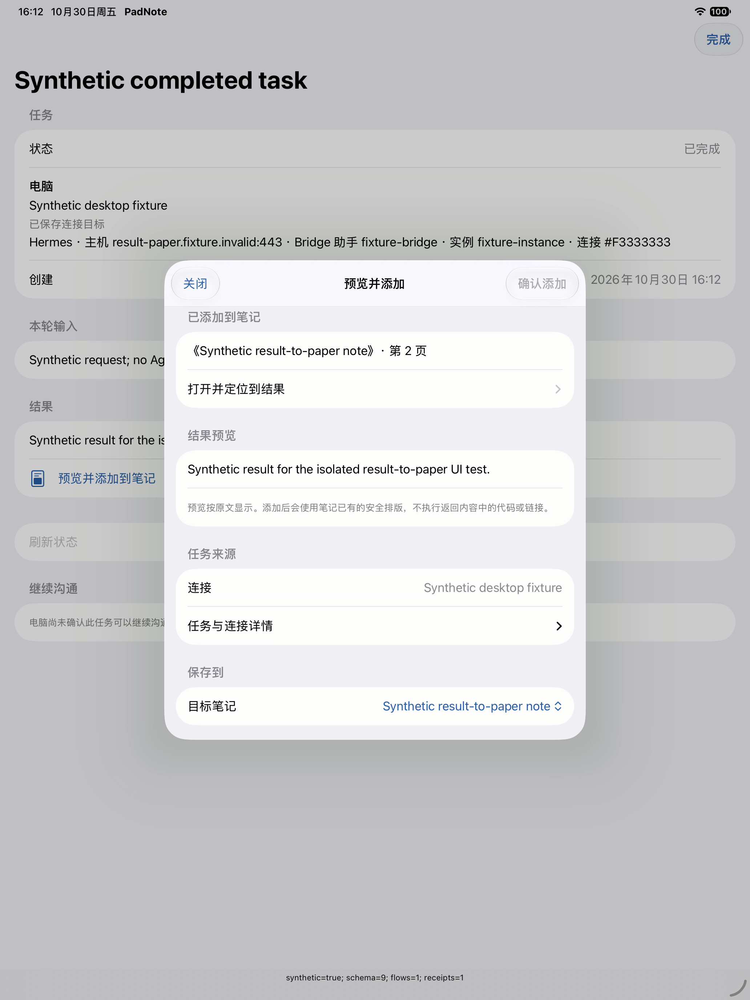</a>

[Watch the result-to-paper example](https://github.com/shiyan688/padnote/releases/download/v0.18.0-beta.34/PadNote-Result-to-Paper.mp4) · [Page placement guide](BETA36_TESTING.md). The video uses synthetic tasks and notes from an earlier version and demonstrates appending to the end. [Media provenance](docs/media/2026-10-30/README.md).

## Demo frames

Paper tools are grouped by writing, color, history, and page actions, with AI, tasks, and sharing kept visible. The computer assistant puts Agent checks, QR pairing, and device approval on one page, and prompts for a new check when results expire. The image below shows the management UI with synthetic data. [Media notes](docs/media/2026-10-29/README.md).

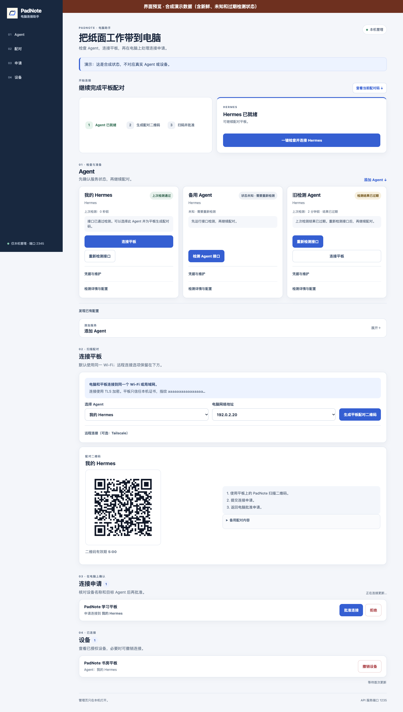

The pictured QR code contains a demo pairing configuration for `demo.invalid`, with no valid pairing code for a real device.

The WSL wizard lets you choose a distribution and Hermes configuration, then review connection changes without exposing key values.

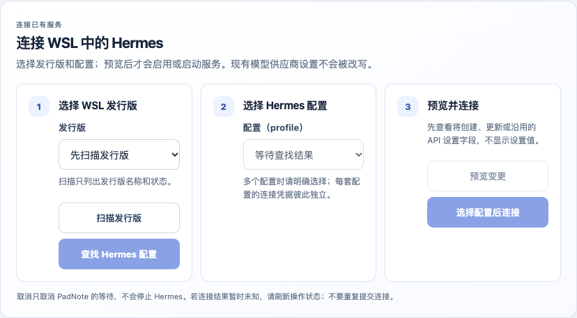

<details>
<summary>Windows launcher and diagnostic controls</summary>

This window was rendered by the new launcher on Windows 11 with synthetic service and Agent state. No real Agent was contacted. [Media notes](docs/media/2026-10-29/README.md).

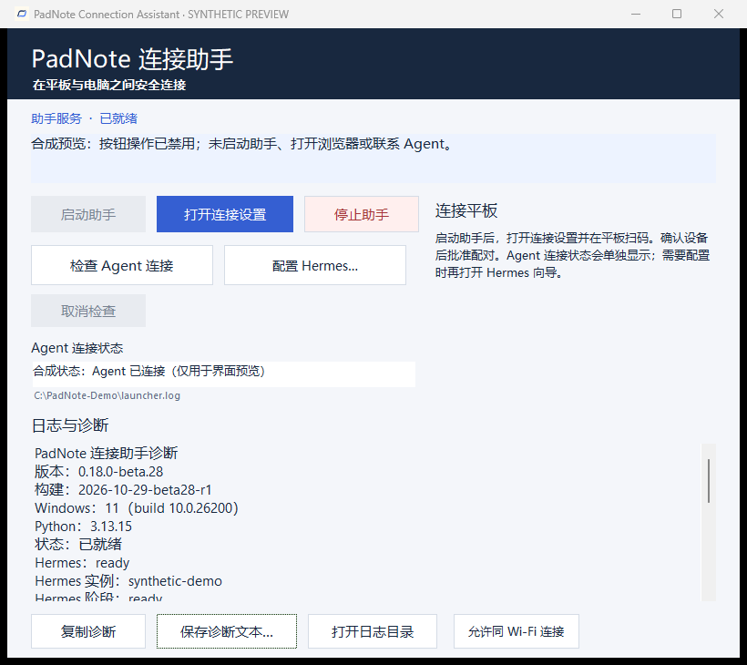

</details>

These real-device frames show a synthetic sample page, task description, and task-preset selector. See the [capture and frame-rate notes](docs/media/2026-10-28/README.md).

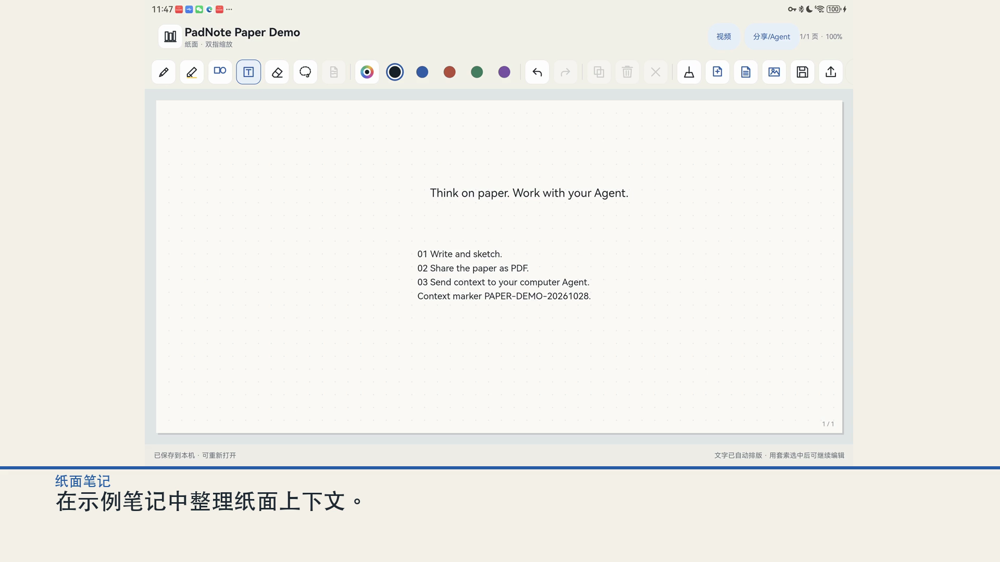

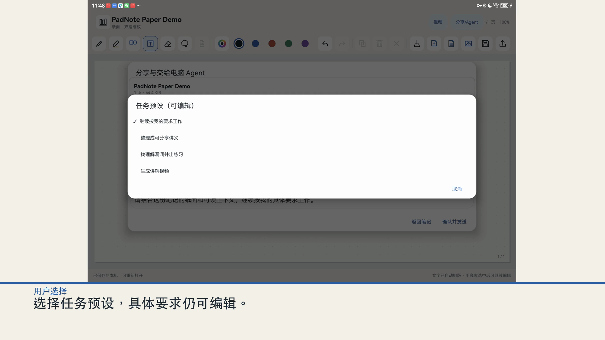

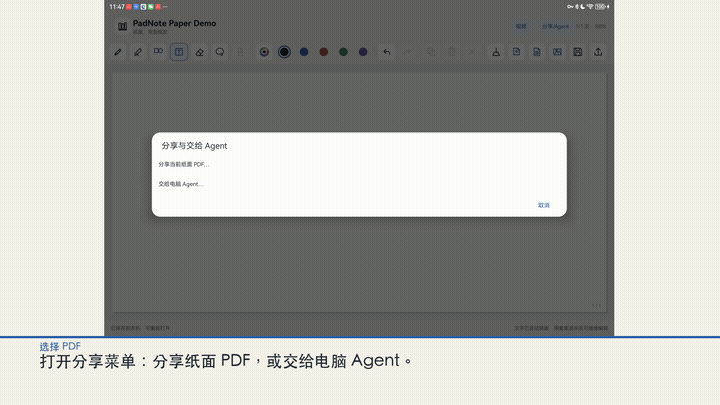

[Watch the tutorial (36 sec)](https://github.com/shiyan688/padnote/releases/download/v0.18.0-beta.18/PadNote-Android-Tutorial-zh.mp4) · [Watch the overview (35 sec)](https://github.com/shiyan688/padnote/releases/download/v0.18.0-beta.18/PadNote-Android-Promo-zh.mp4)

### Exporting the page as PDF

Shared notes should have predictable page sizes. A4-ratio notes export as A4, screen-ratio notes keep their shape, and notes with a PDF background use the first source page's displayed dimensions for every exported page. Content is scaled proportionally, so text and diagrams are not stretched to fill the paper. See the [page-size and sharing guide](docs/BETA25_TESTING.md).

This sample page was exported on an Android tablet. Its example text was typed manually. The PDF preserves the page content for sharing and reading.

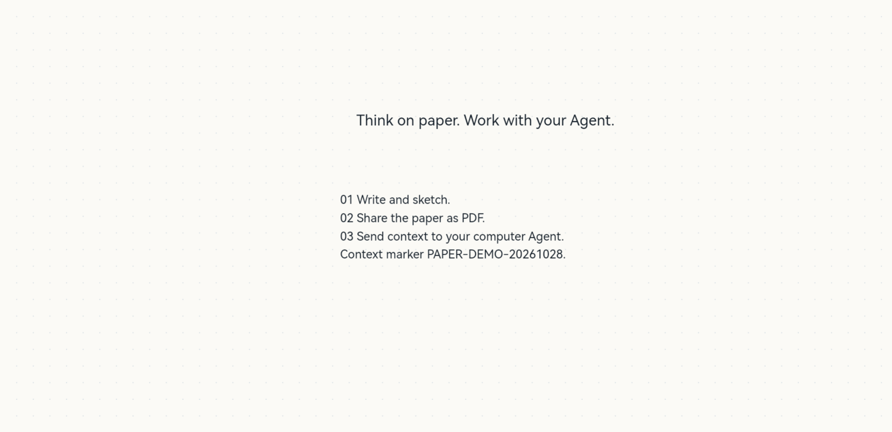

Long notes can also be shared in page form. These are the first, middle, and final pages of an actual 18-page export from the tablet, using 36 paragraphs of synthetic bilingual test content.

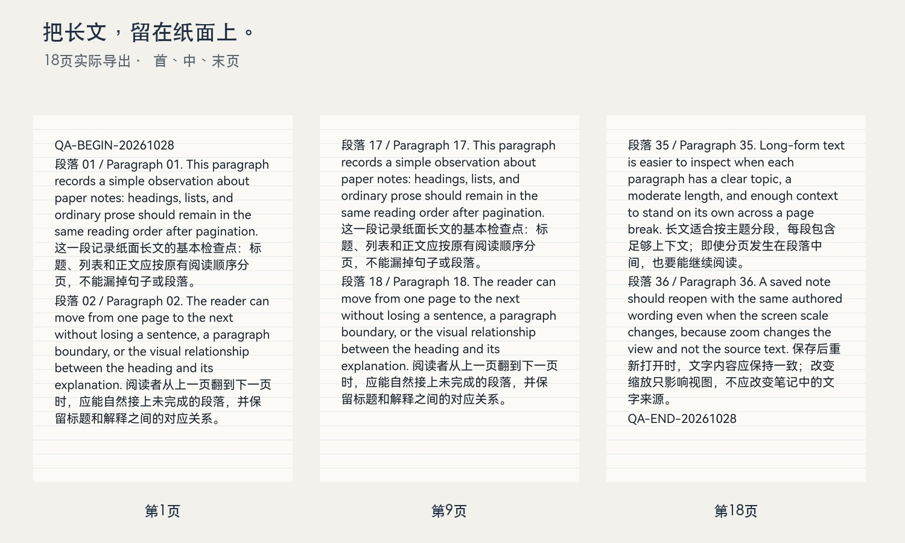

[Watch the PDF preview (30 sec)](https://github.com/shiyan688/padnote/releases/download/v0.18.0-beta.21/PadNote-Paper-PDF-Preview-zh.mp4). This video presents actual exported pages; see the [media notes](docs/media/2026-10-28/README.md).

### A worked learning example

This five-page Bayesian inspection example brings prose, formulas, handwriting, and a decision-flow diagram together. The prose was written by a person, the blue strokes are synthetic, and the diagram was drawn by hand. The 30-second tour at the top uses these real-device screenshots. See the [media notes](docs/media/2026-10-28/README.md) for capture and crop details.


<p align="center">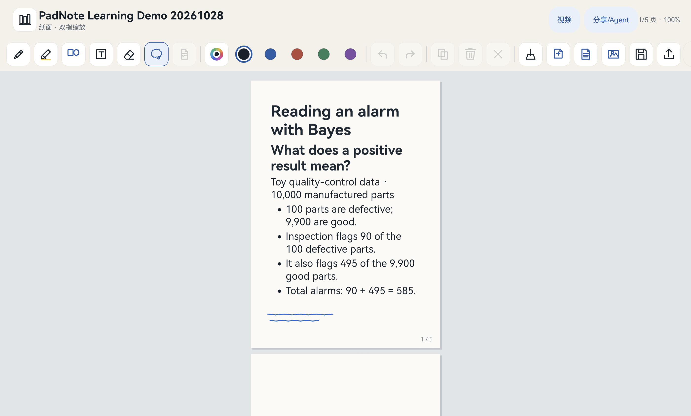</p>

<table>
  <tr>
    <td width="50%">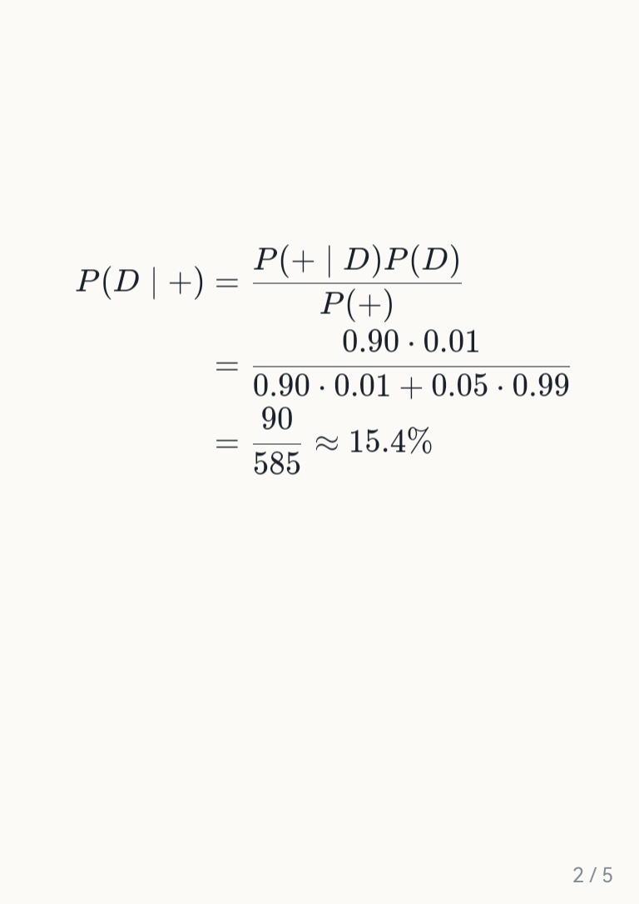</td>
    <td width="50%">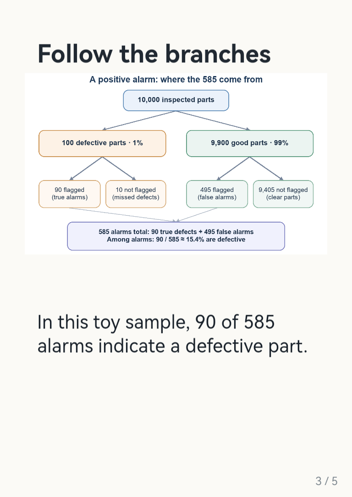</td>
  </tr>
</table>

<details>
<summary>Earlier Android interface screenshots</summary>

These images are from an earlier Android emulator build and show the beta.13 interface.

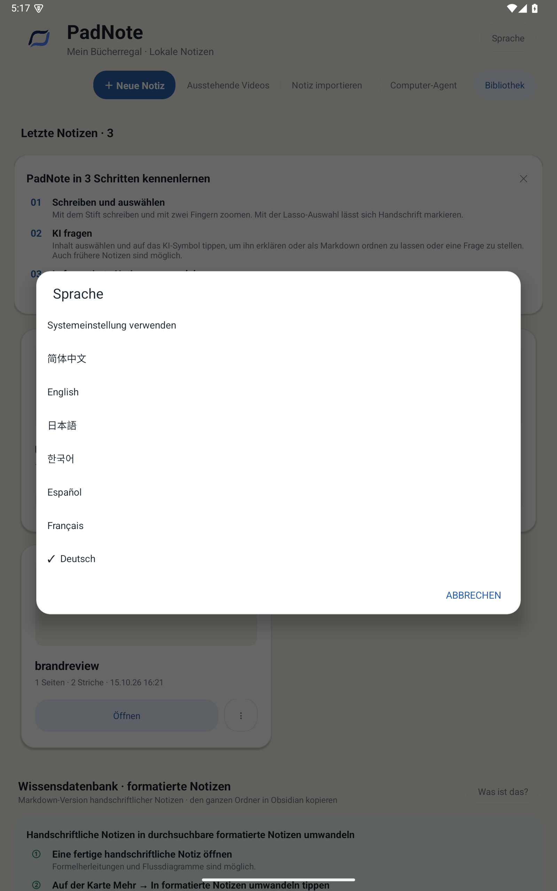

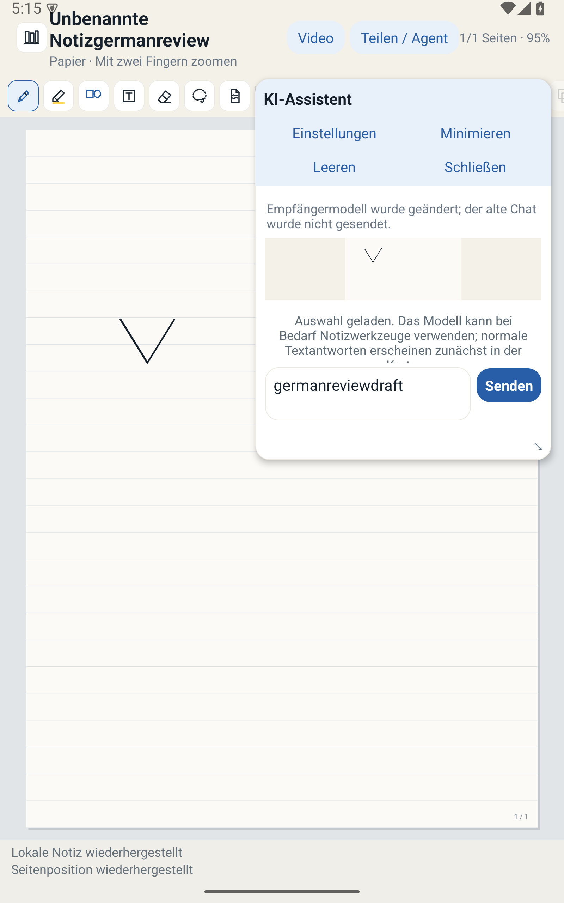

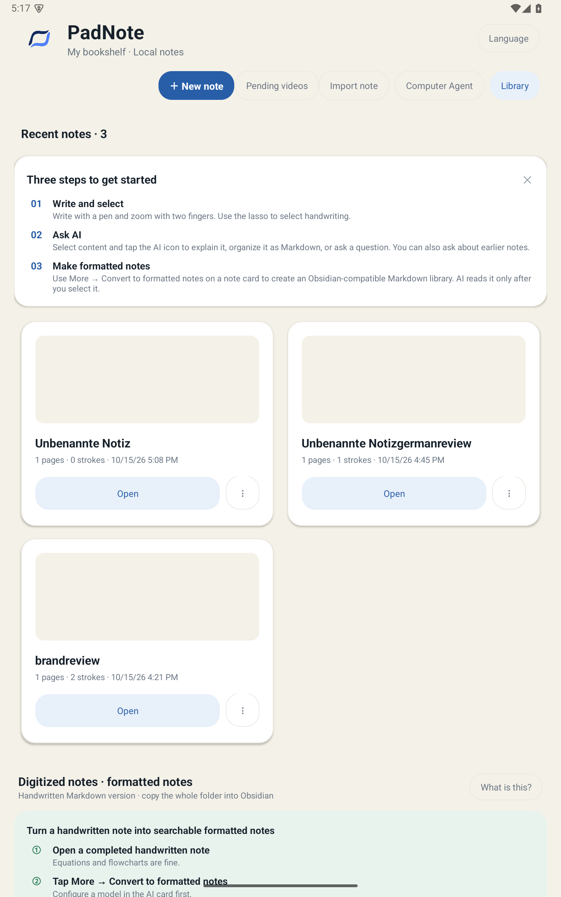

</details>

## Platforms and connections

- **Android tablets:** beta.36 APK (versionCode 69).
- **Windows:** The beta.35 connection assistant has a Setup installer and a portable package. It does not include Hermes, a model, or API credentials. The WSL wizard can be opened from the launcher and lets you review an uncertain operation without resending it.
- **iPad:** Source includes this round of changes; there is no installable signed IPA.

Computer tasks use the Agent you explicitly choose and pair, when it supports PadNote note tasks. Multiple Hermes configurations keep separate Agent identities, credentials, and task ownership. The assistant uses your own configuration and keeps keys in process memory; reopening it requires an explicit reconnect. When gateway mode is unknown, the flow starts with the default configuration and then lets you choose a named configuration. It does not change the provider automatically or restart a gateway managed by another tool. OpenClaw has discovery and setup guidance, but PadNote note tasks are not integrated with OpenClaw; Codex note tasks are not connected.

See the [development status and next steps](docs/DEVELOPMENT_STATUS.md) for more boundaries and project status.

## Downloads and verification

Get the Android APK, Windows connection assistant, full source, and license files from [GitHub Releases](https://github.com/shiyan688/padnote/releases). Android and the desktop assistant update independently: Android updates to beta.36; the Windows assistant remains on beta.35. Verify downloads with `shasum -a 256 <file>` on macOS/Linux or `Get-FileHash <file> -Algorithm SHA256` on Windows using `SHA256SUMS.txt`.

## Build from source

Install JDK 17, Android SDK Platform 35, and Build Tools 35.0.0, then run:

```sh
cd android
./gradlew :app:testDebugUnitTest :app:assembleDebug
```

See the [Windows installer source and build requirements](desktop/connection-assistant/windows-setup/README-WINDOWS.md).

## License and feedback

Original Android/iPad client code is MIT licensed; the video Agent subproject is Apache-2.0. See [`THIRD_PARTY_NOTICES.md`](THIRD_PARTY_NOTICES.md) and [`LICENSING.md`](LICENSING.md) for third-party licenses. For feedback, include the version, device, steps, and visible message. Do not include API keys, pairing tokens, passwords, or private notes.
