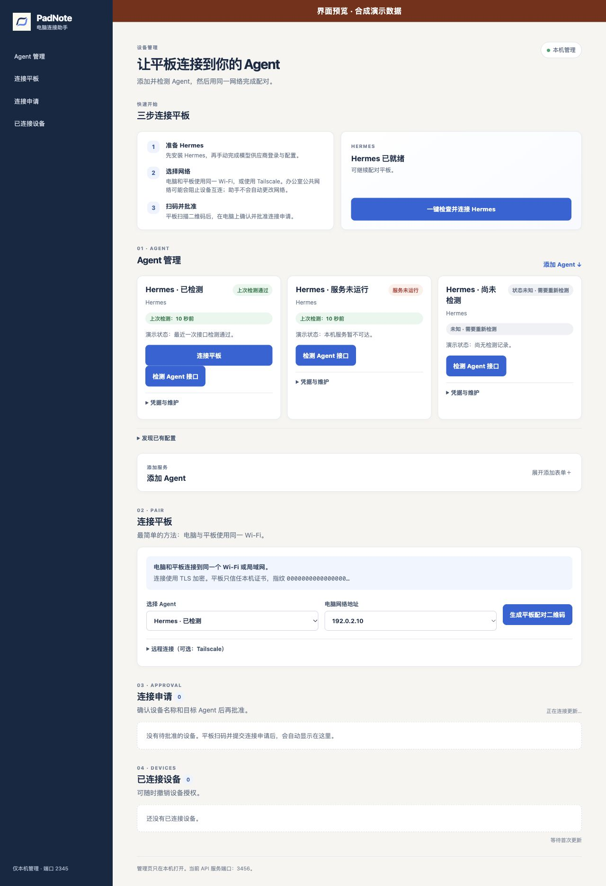

# PadNote


**Learn, write, and discuss on your tablet. Share the current note as a PDF or send it to a computer Agent on your network.**

PadNote brings notes, handwriting, and AI-assisted learning together on one page. Choose your model and service, then read, write, draw, and discuss on the tablet. Export the current note as a PDF when you want to share it, or send the current note and its readable context to a paired computer Agent. You choose the model and service.

| Step | What you do in PadNote | What you get |
| --- | --- | --- |
| 1. Learn and organize | Read, handwrite, draw, and discuss with your chosen model on the tablet page | Notes and ideas stay together on the page |
| 2. Share the page | Export the current note as a PDF, then share it through the system share sheet | Recipients can read the page layout |
| 3. Hand work to a computer Agent | Send page material to a paired Hermes Agent on the same network that supports note tasks | The computer receives the page material and creates a task; track progress in the computer task list and view returned content in the task details |

[Downloads and installers (GitHub Releases)](https://github.com/shiyan688/padnote/releases) · [User guide](docs/BETA24_TESTING.md) · [Selections and gestures](docs/AI_PAPER_SELECTION.md) · [Windows connection assistant notes](desktop/connection-assistant/windows-setup/README-WINDOWS.md) · [Build from source](#build-from-source) · [Report an issue](https://github.com/shiyan688/padnote/issues)

## Demo frames

The desktop connection assistant brings Agent preparation, network choice, QR pairing, and timestamped checks onto one page. The image below shows the layout rendered with synthetic data.



These selected frames show the sample paper, task description, and task-preset selector. They were captured from the beta.17 UI as a low-frame-rate sequence of real device screenshots. Note text was typed manually as synthetic sample content; no Agent result is shown. See the [media provenance note](docs/media/2026-10-28/README.md).


[Watch the tutorial (36 sec)](https://github.com/shiyan688/padnote/releases/download/v0.18.0-beta.18/PadNote-Android-Tutorial-zh.mp4) · [Watch the overview (35 sec)](https://github.com/shiyan688/padnote/releases/download/v0.18.0-beta.18/PadNote-Android-Promo-zh.mp4)

### Exporting the page as PDF

This sample page was exported on an Android tablet. Its example text was typed manually. The PDF preserves the page content for sharing and reading.


Long notes can also be shared in page form. These are the first, middle, and final pages of an actual 18-page export from the tablet, using 36 paragraphs of synthetic bilingual test content.


[Watch the PDF preview (30 sec)](https://github.com/shiyan688/padnote/releases/download/v0.18.0-beta.21/PadNote-Paper-PDF-Preview-zh.mp4). This video presents actual exported pages; see the [media notes](docs/media/2026-10-28/README.md).

### A worked learning example

These images show a five-page Bayesian inspection example, from the paper view to a closer look at its formula and decision-flow diagram. The prose was written by a person, the blue strokes are synthetic, and the diagram was drawn by hand; no model or Agent output is included. The app screenshots were captured on a beta.17 tablet and do not show beta.23 running. See the [media notes](docs/media/2026-10-28/README.md) for capture and crop details.


[](https://github.com/shiyan688/padnote/releases/download/v0.18.0-beta.24/PadNote-Learning-Tour-20261028.mp4)

[Watch the 30-second real-device screenshot tour](https://github.com/shiyan688/padnote/releases/download/v0.18.0-beta.24/PadNote-Learning-Tour-20261028.mp4). It uses fixed screenshots from the previously published synthetic learning note, with dissolves; it is not a continuous beta.24 interaction recording. See the [media notes](docs/media/2026-10-28/README.md).


<p align="center"></p>

<table>
  <tr>
    <td width="50%"></td>
    <td width="50%"></td>
  </tr>
</table>

<details>
<summary>Earlier Android interface screenshots</summary>

These images are from an earlier Android emulator build and show the beta.13 interface.


</details>

## Platforms and connections

- **Android tablets:** Installable APKs are available through GitHub Releases.
- **Windows:** The connection assistant is a separately distributed companion for pairing and Agent connections. It does not include Hermes, a model, or API credentials.
- **iPad:** Source is available; there is no installable signed IPA.

Computer tasks currently require a paired Hermes Agent that supports PadNote note tasks. Tasks are saved on the computer before PadNote waits for a Hermes run ID; uncertain outcomes are not automatically replayed. You configure the model provider. OpenClaw has discovery and setup guidance, but that does not mean PadNote note tasks are integrated with OpenClaw. Codex note tasks are not connected. Hermes in WSL must expose an API reachable from Windows; automatic WSL Agent discovery is not available.

See the [development status and next steps](docs/DEVELOPMENT_STATUS.md) for more boundaries and project status.

## Downloads and verification

Get the Android APK, Windows connection assistant, full source, and license files from [GitHub Releases](https://github.com/shiyan688/padnote/releases). Verify downloads with `shasum -a 256 <file>` on macOS/Linux or `Get-FileHash <file> -Algorithm SHA256` on Windows using `SHA256SUMS.txt`.

## Build from source

Install JDK 17, Android SDK Platform 35, and Build Tools 35.0.0, then run:

```sh
cd android
./gradlew :app:testDebugUnitTest :app:assembleDebug
```

See the [Windows installer source and build requirements](desktop/connection-assistant/windows-setup/README-WINDOWS.md).

## License and feedback

Original Android/iPad client code is MIT licensed; the video Agent subproject is Apache-2.0. See [`THIRD_PARTY_NOTICES.md`](THIRD_PARTY_NOTICES.md) and [`LICENSING.md`](LICENSING.md) for third-party licenses. For feedback, include the version, device, steps, and visible message. Do not include API keys, pairing tokens, passwords, or private notes.
