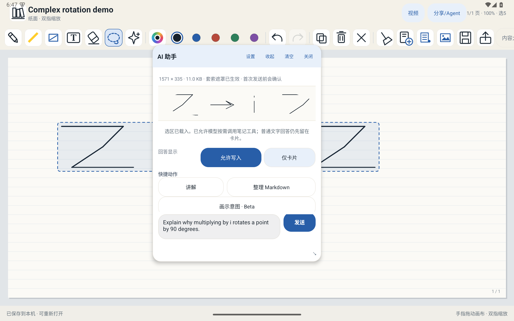
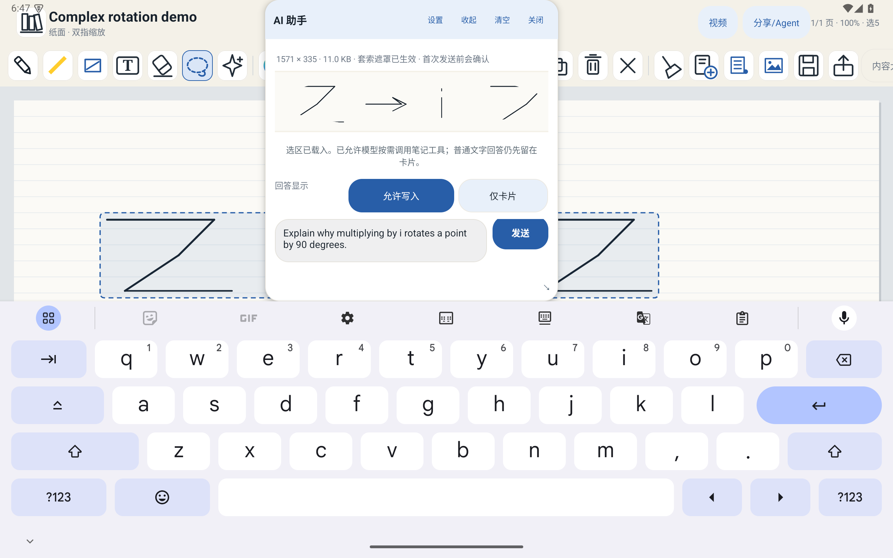
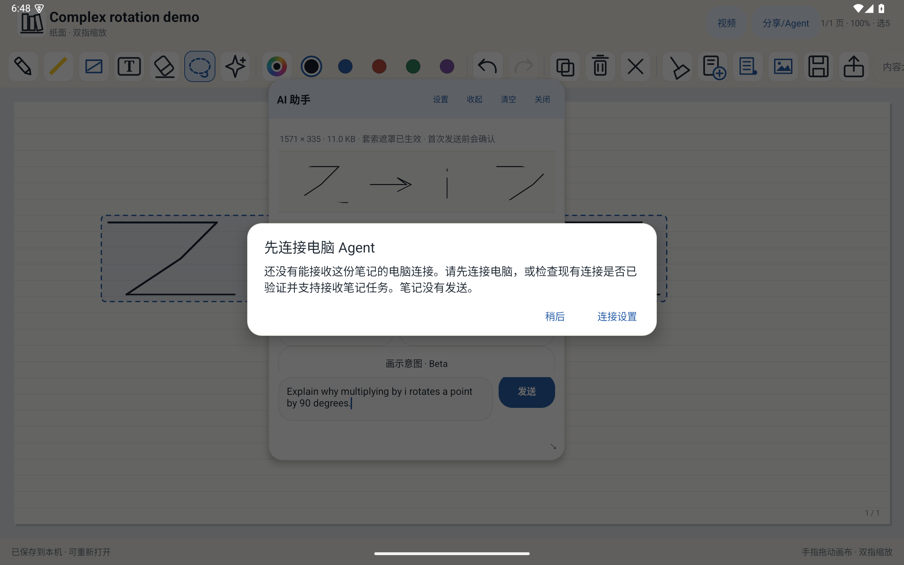

# PadNote

**在同一张纸上写、画、提问，再分享或交给电脑 Agent。**

PadNote 是开源的平板笔记与 AI 学习工具。Android 可在同一份笔记中书写、绘图和交流，导出完整纸面 PDF，或把当前笔记材料交给已配对的 Hermes 电脑助手。模型与服务由你选择。

[Android beta.12 测试版](https://github.com/shiyan688/padnote/releases/tag/v0.18.0-beta.12) · [下载 APK](https://github.com/shiyan688/padnote/releases/download/v0.18.0-beta.12/PadNote-Android-0.18.0-beta.12-debug.apk) · [Windows 安装程序](https://github.com/shiyan688/padnote/releases/download/v0.18.0-beta.11/PadNote-Connection-Assistant-0.18.0-beta.11-Setup-x64.exe) · [测试指南](docs/BETA12_TESTING.md) · [源码构建](#从源码构建) · [反馈问题](https://github.com/shiyan688/padnote/issues)

Android 35 模拟器实测截图。纸面与问题均为合成示例；示例问题未发送。







## beta.12 更新

本版统一 Android 纸面工具栏、AI 卡片和表单中的操作按钮与图标。AI 输入框会随长内容伸展为两到三行；键盘打开时输入框和发送按钮仍可用，屏幕旋转后 AI 卡片保持可见。尚未连接电脑 Agent 时，点击“连接设置”即可进入配置。Windows x64 连接助手沿用 beta.11 安装程序，本轮没有修改 Windows 助手。

Android APK 适用于 Android 7.0 / API 24 及以上，包名为 `com.padnote.android.beta`。APK 使用与 beta.11 相同的签名，可覆盖安装。安装前请备份重要笔记。测试范围与结果见[测试指南](docs/BETA12_TESTING.md)。

## 功能范围与边界

在当前笔记中书写、编辑、缩放并进行 AI 交流；分享完整纸面 PDF；将当前笔记的 PDF 和可读上下文发送给已配对且支持纸面任务的 Hermes Agent。模型、TTS 和视频工具由你或所选 Agent 配置，PadNote 不要求特定供应商。OpenClaw 目前仅提供发现与设置引导，Codex 纸面任务尚未接入。iPad 有源码，暂无可安装的签名 IPA。

电脑助手不附带 Hermes、模型、API 密钥或视频运行时。WSL Hermes 需要启用且可从 Windows 访问的 API；助手不会自动扫描 WSL。外部模型或工具可能产生费用。发送前检查材料范围、目标和任务。

## 下载与验证

Release 提供 Android APK、Windows x64 安装程序、源码 ZIP、测试指南、许可文件和 `SHA256SUMS.txt`。本版没有重复发布 beta.11 演示视频。Windows 安装程序在 Windows 11 x64 的 SSH Session 0 完成安装、启动停止、服务、同版本重装和卸载检查；这不代表普通桌面鼠标操作、同 Wi-Fi 配对或真实 Hermes 任务已验证。安装程序未签名。

下载后在 macOS/Linux 使用 `shasum -a 256 <文件>`，Windows 使用 `Get-FileHash <文件> -Algorithm SHA256` 核对校验和。

## 从源码构建

Android 需要 JDK 17、Android SDK Platform 35 和 Build Tools 35.0.0：

```sh
cd android
./gradlew :app:testDebugUnitTest :app:assembleDebug
```

Windows 安装程序源码和构建前提见 [`desktop/connection-assistant/windows-setup/README-WINDOWS.md`](desktop/connection-assistant/windows-setup/README-WINDOWS.md)。

## 许可与反馈

Android 与 iPad 客户端自研代码采用 MIT；视频 Agent 子项目采用 Apache-2.0；第三方依赖许可见 [`THIRD_PARTY_NOTICES.md`](THIRD_PARTY_NOTICES.md) 与 [`LICENSING.md`](LICENSING.md)。反馈时请说明版本、设备、步骤和实际提示。请勿上传 API Key、配对令牌、密码或私人笔记。
