# PadNote


**把想法写在纸上，让 AI 看懂，再把工作交给电脑。**

PadNote 是面向平板的开源 AI 笔记应用。读一份材料，写下推导，画出关系，围绕同一张纸面交流。整理好的内容可以直接导出 PDF 分享，也可以连同上下文发送给同网络中已配对的电脑 Agent，接着执行任务；完成的文字结果可先预览，再添加回笔记。模型与服务由你选择。

## 从一行真实手写开始

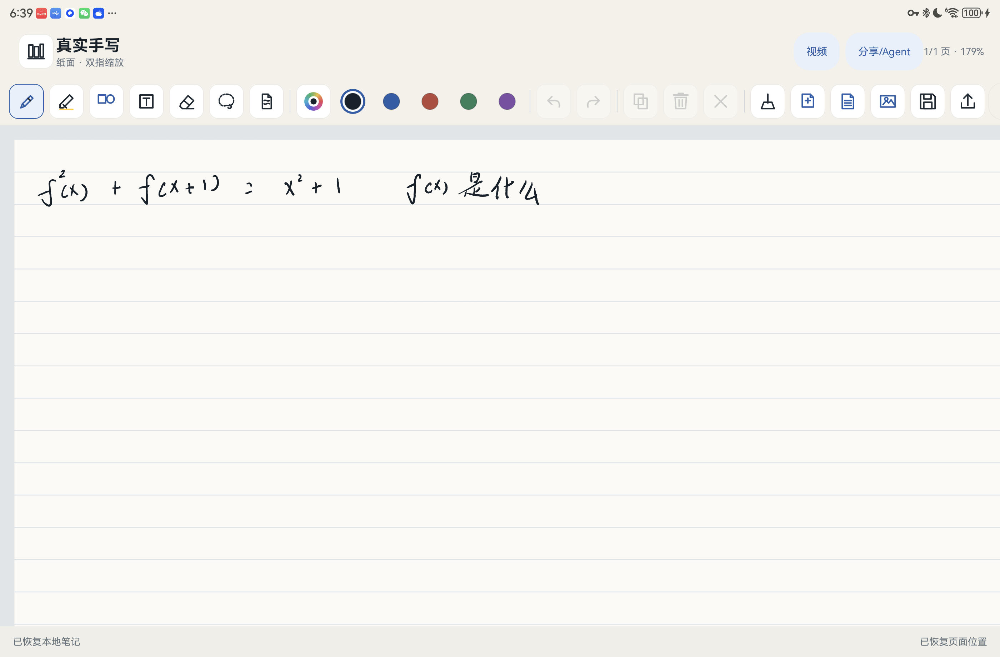

在平板上写下一道函数题，再围绕同一张纸继续讨论。需要绘图或运行代码时，把纸面和任务说明一起交给电脑 Agent。上图保留作者的原始笔迹，已授权公开。[素材来源](docs/media/2026-10-31/README.md)。

[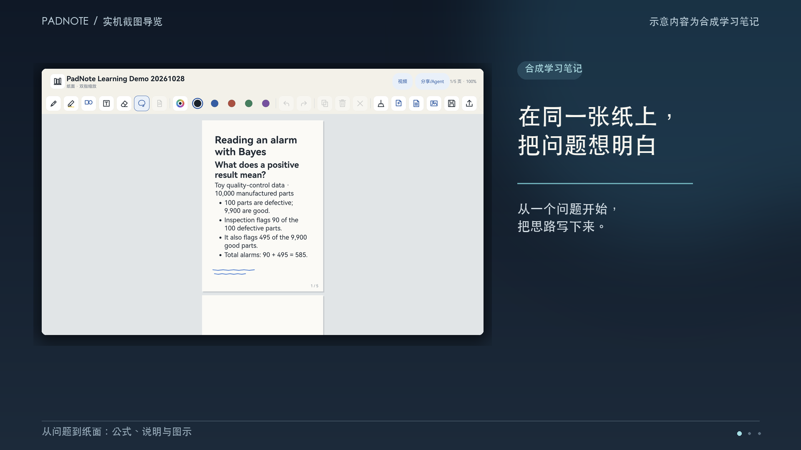](https://github.com/shiyan688/padnote/releases/download/v0.18.0-beta.24/PadNote-Learning-Tour-20261028.mp4)

[观看学习笔记导览（30 秒）](https://github.com/shiyan688/padnote/releases/download/v0.18.0-beta.24/PadNote-Learning-Tour-20261028.mp4) · [下载应用与电脑助手](https://github.com/shiyan688/padnote/releases) · [English](README.en.md)

此前的视频使用合成学习内容和实机截图，展示纸面与分享效果，并非实时 Agent 执行录像。下方静态函数图来自一次真实 Hermes Agent API 返回，但它是与手写题分开的 `y=x²` 示例，不是原题答案。素材来源与验收状态见[手写页与 Agent 图示说明](docs/REAL_HANDWRITING_AGENT_DEMO.md)。

## 一张真实手写页与独立 Agent 函数图

左侧是作者授权公开的原始平板手写页；中间是一次真实 Hermes Agent 返回的独立 `y=x²` 函数图 SVG，经本地渲染成 PNG。右侧展示它通过 Android 正常图片选择器手动导入、保存并重开的纸面效果。原手写内容留在第 1 页，函数图放在第 2 页；两页 PDF 已逐页查看。函数图不是手写题答案，也不是 Android 自动取得的 Agent 任务结果。

| 作者原始手写 | 真实 Agent 返回的独立图示 | Android 手动导入后重开 |
| --- | --- |
|  | 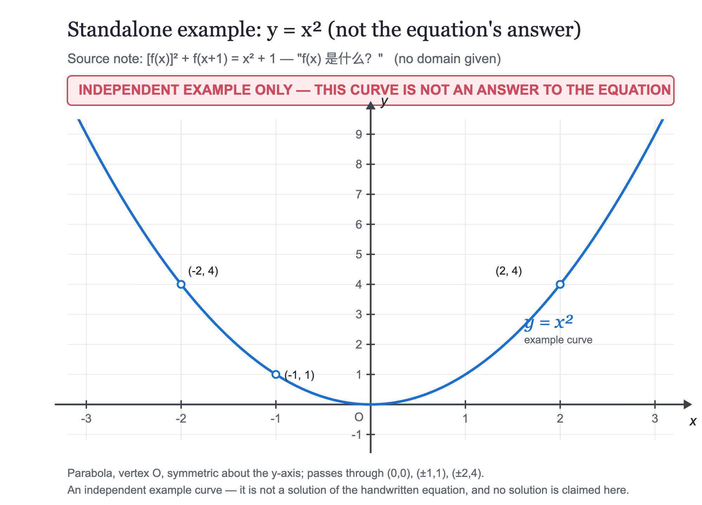 | 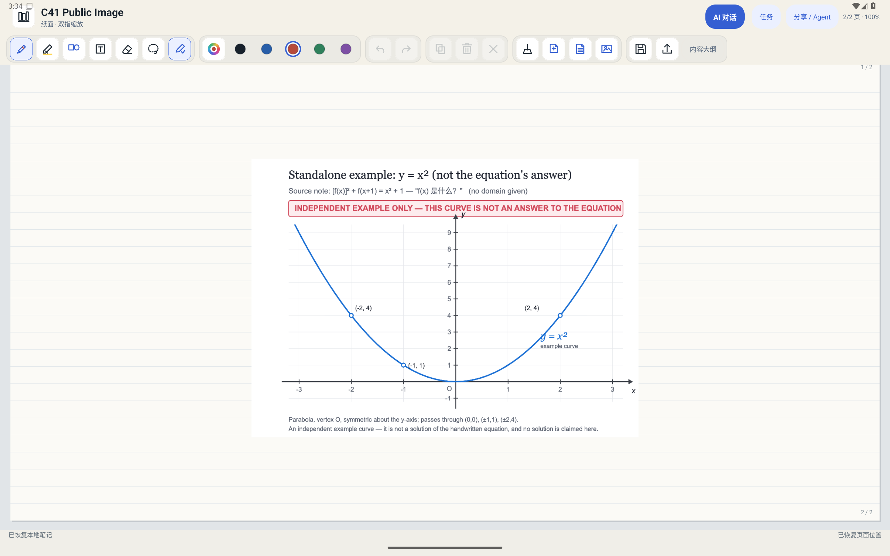 |

[查看 SVG 源文件与素材来源](docs/REAL_HANDWRITING_AGENT_DEMO.md)。

| 步骤 | 在 PadNote 中做什么 | 结果 |
| --- | --- | --- |
| 1. 学习与整理 | 在平板纸面上阅读、手写、绘图，并与所选模型交流 | 笔记与想法留在同一张纸面上 |
| 2. 分享纸面 | 导出当前笔记的 PDF，再通过系统分享发送 | 收件人可阅读纸面版式 |
| 3. 交给电脑 Agent | 将纸面材料发送给同一网络中已配对、支持笔记任务的 Hermes Agent | 在电脑任务列表查看进度；完成后预览结果并可添加回笔记 |

[下载与安装包（GitHub Releases）](https://github.com/shiyan688/padnote/releases) · [任务结果回到纸面](BETA34_TESTING.md) · [PDF 分享指南](docs/BETA25_TESTING.md) · [文字编辑与草稿](docs/BETA26_TESTING.md) · [笔记移除与恢复](docs/BETA27_TESTING.md) · [界面与操作指引](docs/BETA28_TESTING.md) · [WSL 任务与配置连接](BETA32_TESTING.md) · [Beta 41 Windows 连接助手](BETA41_TESTING.md) · [Beta 40 连接检查改进](BETA40_TESTING.md) · [Beta 39 图像回纸面与兼容检查](BETA39_TESTING.md) · [Beta 38 排版历史](BETA38_TESTING.md) · [纸面选区与手势](docs/AI_PAPER_SELECTION.md) · [Windows 连接助手说明](desktop/connection-assistant/windows-setup/README-WINDOWS.md) · [从源码构建](#从源码构建) · [反馈问题](https://github.com/shiyan688/padnote/issues)


## 从一份示例开始

第一次打开时，在书架选择“打开示例笔记”，试着写、圈选和分享。想把材料交给电脑时，再按助手中的四个步骤完成检测、配对、批准和首次任务。任务说明提供简短批注、完整推导、复习卡片三种形式，可以自行修改。[使用步骤](BETA35_TESTING.md)。

<details>
<summary>查看示例笔记与电脑助手</summary>

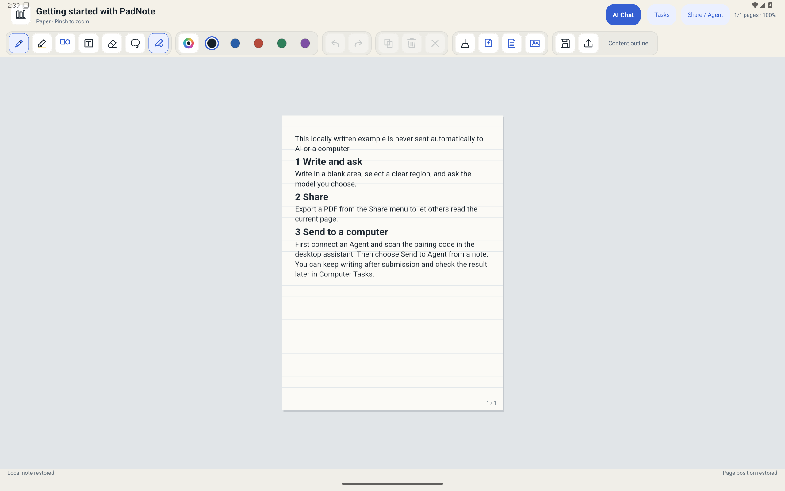

电脑助手示意，使用合成服务状态。

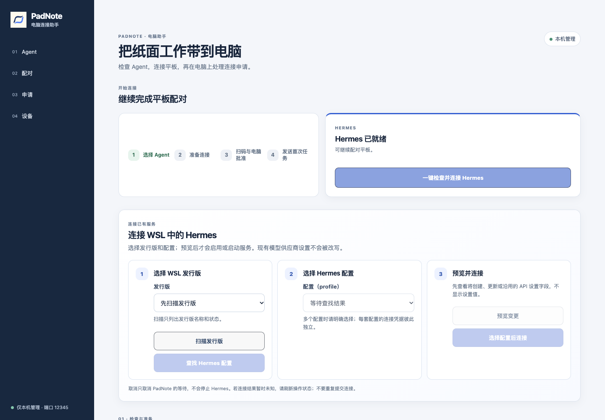

[素材来源](docs/media/2026-10-31/README.md)。

</details>

## 电脑连接引导

发送后继续写，顶部“查看进度”可随时回到这条任务。若接收情况不明确，可在详情中点“确认电脑是否收到”，继续跟踪原任务，无需重新整理材料。连接助手会就地解释 WSL 或 Hermes 配置问题，并提供重试与安装指引。

[观看电脑连接引导（约 37 秒）](https://github.com/shiyan688/padnote/releases/download/v0.18.0-beta.33/PadNote-Connection-Guide.webm)

[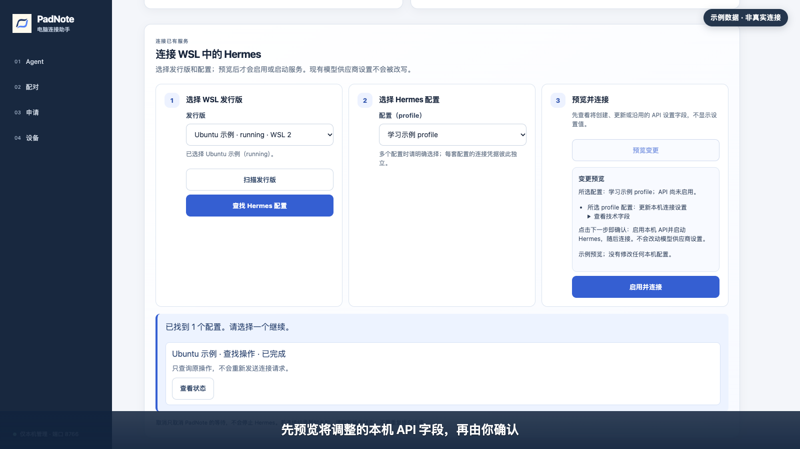](https://github.com/shiyan688/padnote/releases/download/v0.18.0-beta.33/PadNote-Connection-Guide.webm)

合成界面与示例状态。[素材来源与范围](docs/media/2026-10-29/README.md)。

## 任务结果回到纸面

完成的文字结果可以先看真实纸面预览，再放在笔记末尾，或在目标页点选起点、调整文字宽度。长回答会继续分页；遇到已有文字、手写、图片或 PDF 正文重叠时，先换个落点或调整宽度，再确认添加。原稿保留在原位。

Bridge 任务完成后列出的 PNG/JPEG 图像也可先预览，再由用户确认放置到纸面；普通文件仍可下载。确认插图后笔记升级到 schema 11，较旧版本无法打开这类笔记。详见[Agent 图像放置与兼容说明](docs/AGENT_IMAGE_TO_PAPER.md)。

<a href="https://github.com/shiyan688/padnote/releases/download/v0.18.0-beta.34/PadNote-Result-to-Paper.mp4">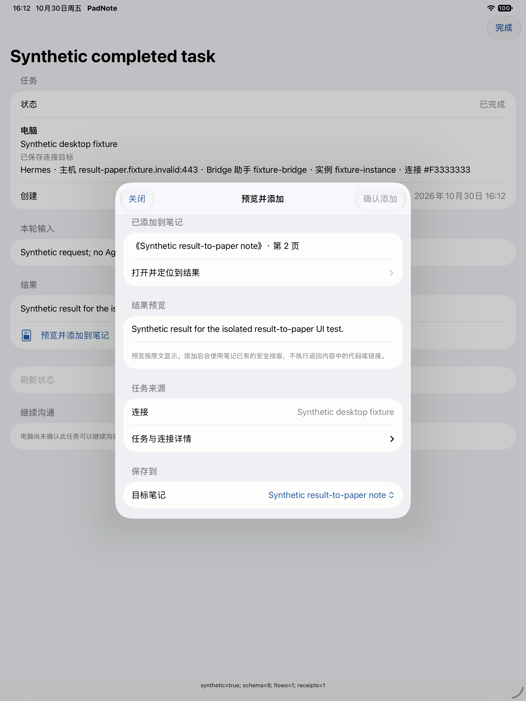</a>

[观看结果添加示例](https://github.com/shiyan688/padnote/releases/download/v0.18.0-beta.34/PadNote-Result-to-Paper.mp4) · [纸面落点使用步骤](BETA36_TESTING.md)。视频使用较早版本的合成任务与笔记内容，展示末尾添加流程。[素材说明](docs/media/2026-10-30/README.md)。

## 演示画面

纸面工具按书写、配色、撤销和页面操作分组；AI 对话、任务与分享入口保持可见。电脑助手把 Agent 检查、扫码配对与设备批准放在同一页，检测过期时会提示重新检查。下图使用合成数据展示电脑助手的管理页布局。[素材说明](docs/media/2026-10-29/README.md)。

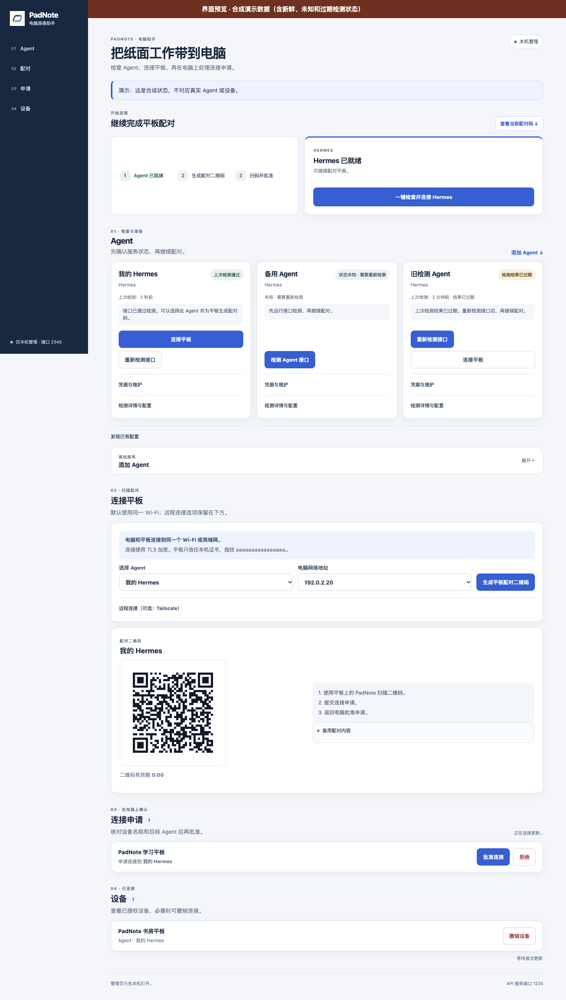

图中二维码为演示配对配置，目标地址是 `demo.invalid`，不含真实设备的有效配对码。

WSL 向导让你明确选择发行版与 Hermes 配置，并在连接前查看不含密钥值的变更预览。

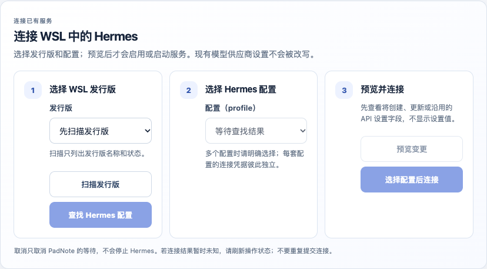

<details>
<summary>Windows 启动器与诊断入口</summary>

下面是在 Windows 11 上运行新版启动器得到的合成状态窗口。用于展示服务状态、Agent 检查和诊断入口；没有联系真实 Agent。[素材说明](docs/media/2026-10-29/README.md)。

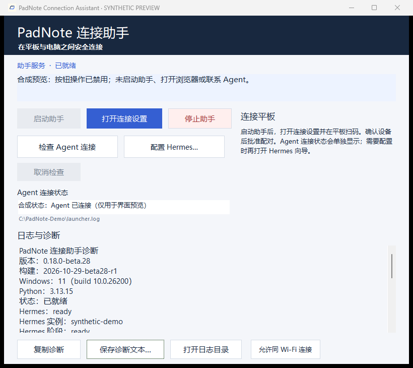

</details>

以下画面展示平板纸面、任务说明与预设选择，来自合成示例的实机截图。[拍摄与帧率说明](docs/media/2026-10-28/README.md)。

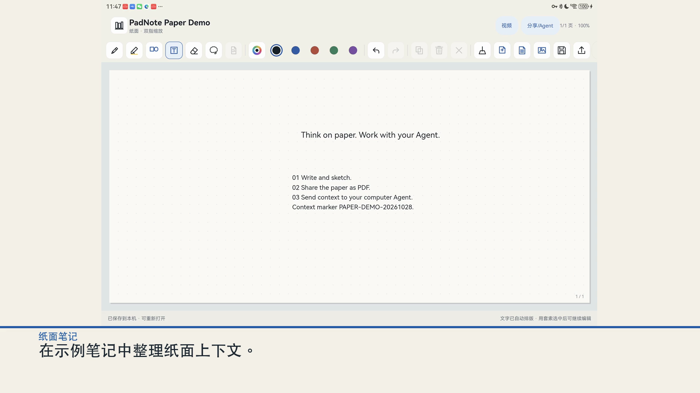

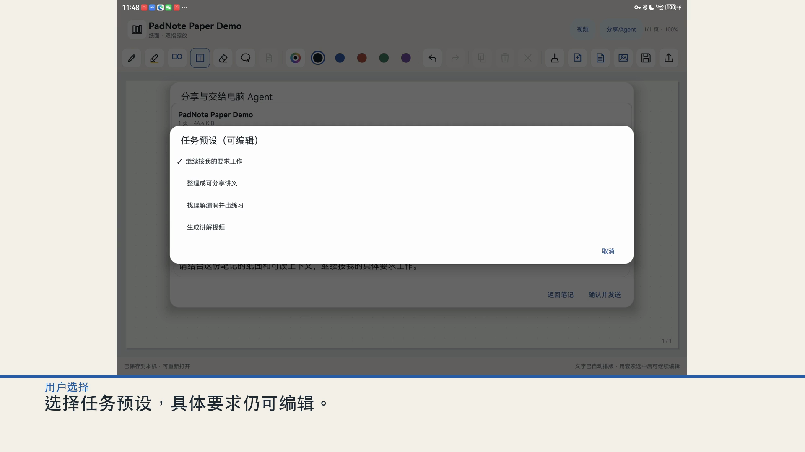

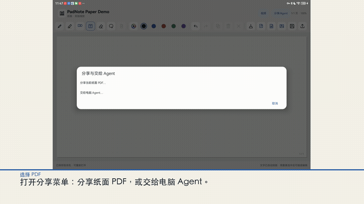

[观看教程版（36 秒）](https://github.com/shiyan688/padnote/releases/download/v0.18.0-beta.18/PadNote-Android-Tutorial-zh.mp4) · [观看简介版（35 秒）](https://github.com/shiyan688/padnote/releases/download/v0.18.0-beta.18/PadNote-Android-Promo-zh.mp4)

### 纸面导出为 PDF

把学习成果发给别人时，纸张大小也应可预期。A4 比例笔记按 A4 导出，屏幕比例笔记保留原形状；带 PDF 背景的笔记沿用源文件第一页的显示尺寸，统一整本笔记。导出时等比例放置内容，文字与图表不会为填满纸张而变形。[查看尺寸与分享说明](docs/BETA25_TESTING.md)。

下面是 Android 平板实际导出的示例页面，文字由人工输入。PDF 保留纸面内容，便于通过系统分享交给他人阅读。

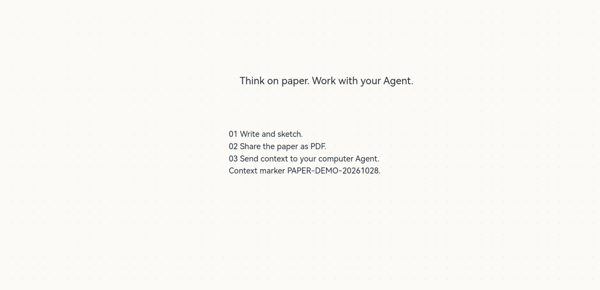

长文也可以按纸面形式分享。下面取自一份在平板上实际导出的 18 页测试笔记，分别展示首、中、末页；36 段双语文字均为合成测试内容。

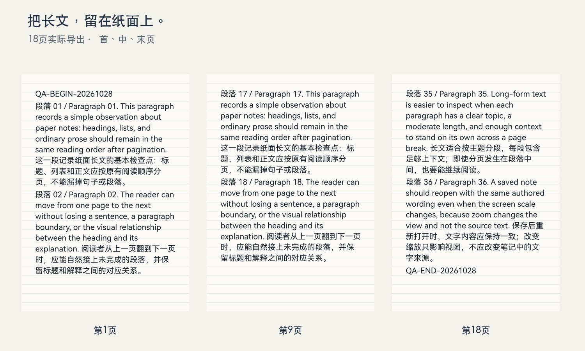

[观看长文 PDF 效果（30 秒）](https://github.com/shiyan688/padnote/releases/download/v0.18.0-beta.21/PadNote-Paper-PDF-Preview-zh.mp4)。这是实际导出页面的展示视频；素材来源见[说明](docs/media/2026-10-28/README.md)。

### 一页学习示例

这份五页的贝叶斯检测示例把文字、公式、笔迹和分支图放在一起。文字由人工编写，蓝色笔迹为合成样例，流程图为手工绘制。首页的 30 秒导览由这些实机截图制作；截图与裁切信息见[演示素材说明](docs/media/2026-10-28/README.md)。


<p align="center">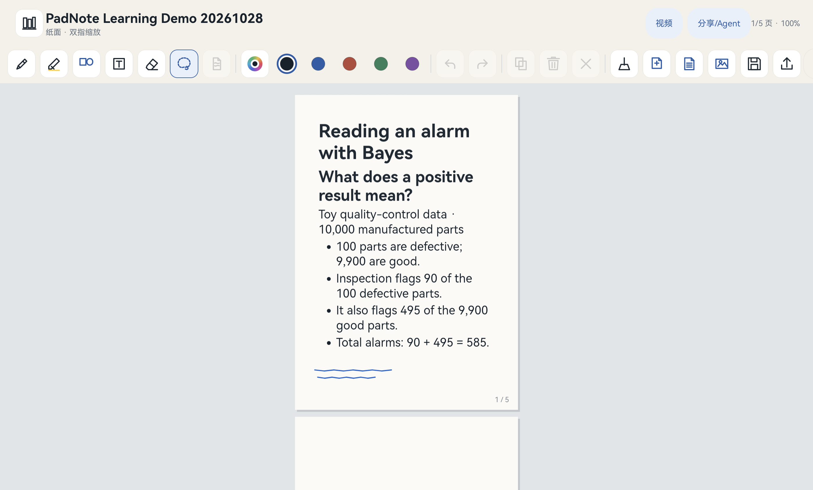</p>

<table>
  <tr>
    <td width="50%">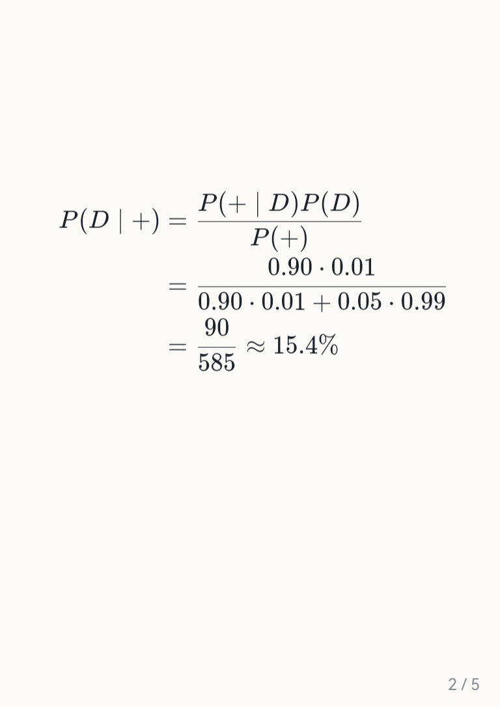</td>
    <td width="50%">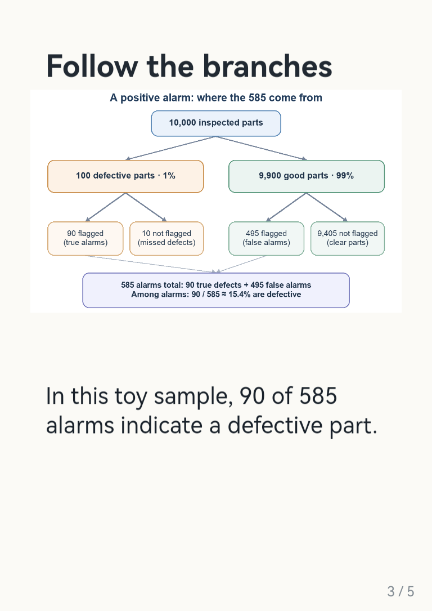</td>
  </tr>
</table>

<details>
<summary>早期 Android 界面截图</summary>

以下图片来自早期 Android 模拟器，展示的是 beta.13 界面。

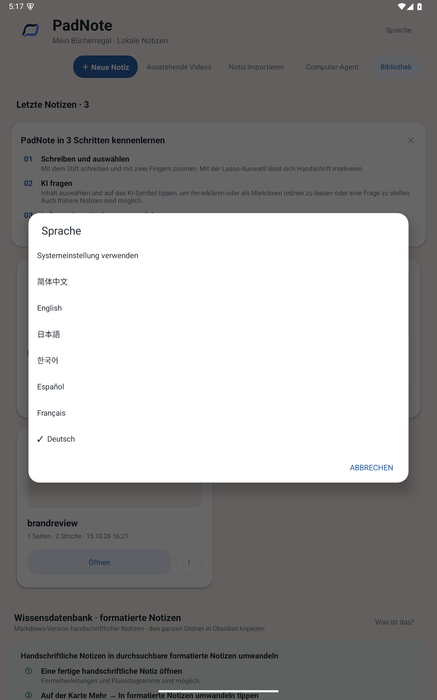

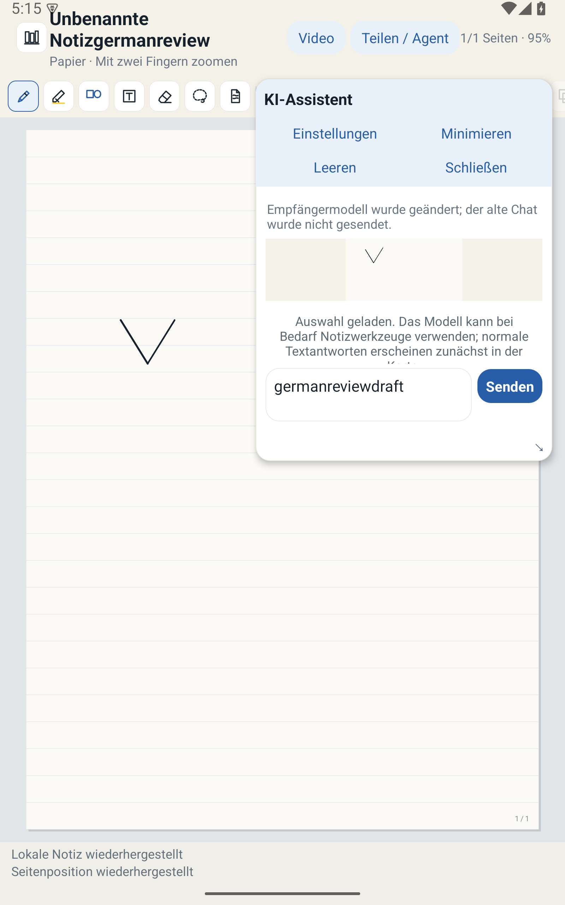

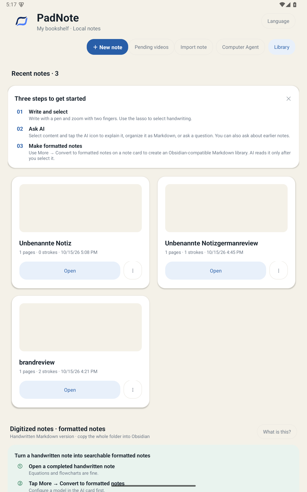

</details>

## Beta 39：把 Agent 图像放回纸面

电脑任务完成后，支持的 PNG/JPEG 附件可预览并调整位置与大小，再确认添加到原笔记或新笔记。取消不会留下空白条目；添加后可从原任务再次打开笔记。若图像与已有内容重叠，可在确认前检查并调整；纸面上的原有内容不会被移动或删除。

只有确认添加图像的笔记才升级到 schema 11，较早版本无法打开这类笔记。普通笔记不变；详见[图像放置与兼容说明](docs/AGENT_IMAGE_TO_PAPER.md)及[Beta 39 检查说明](BETA39_TESTING.md)。

## Beta 41：Windows 连接助手状态与安装清理

仅找到 Hermes 配置不代表服务已连接。助手只有在最近 60 秒内通过检查、并确认具备任务执行能力后才显示“已就绪”；结果过期后需要用户手动重新检查，不会因打开界面自动探测或启动 Gateway。

安装清理只移除安装目录中已知的 Python 字节码缓存，不会递归删除未知文件。beta.37 原位升级到 beta.41 的 Windows 实机验收已完成：Setup 成功运行，243 个安装文件均通过核验，配对状态、持久记录、源码目录 ACL 与 TLS 身份均保留，安装后未发现字节码缓存。验收期间未重启 Hermes，也未重提旧任务；卸载流程未测试。详见[Beta 41 检查说明](BETA41_TESTING.md)。

Android 仍提供 beta.40（versionCode 73）安装包；本版没有新的 Android 构建。iPad 提供源码，不含签名 IPA；Windows 连接助手更新至 beta.41，beta.37 到 beta.41 原位升级已通过验收，配对与任务记录保留；卸载流程未测试。上方展示的是实际手动导入并保存重开的 Android 笔记，函数图仍为独立示例，不是原题解答。

## Beta 38：纸面排版切换

打开旧笔记时，原有排版保持不变。想换用新版时，先预览整张纸面，再确认切换。新版改善粗体与行内公式、嵌套强调和分隔线的呈现，同时保留代码、表格、链接、引用和数学内容。切回旧版只改变排版，不撤回当前文字或自动缩减已有页面。

新版格式使用 schema 10，较早版本的 PadNote 不支持。把新格式笔记发到其他设备前，请先更新那台设备。

同一段合成测试文字的旧版与新版 Android 导出效果见下图。它们展示纸面排版，不是 AI 或 Agent 的回答。打开旧笔记后可先看完整预览，再决定是否采用新版。

| 旧版排版 | 新版排版 |
| --- | --- |
| 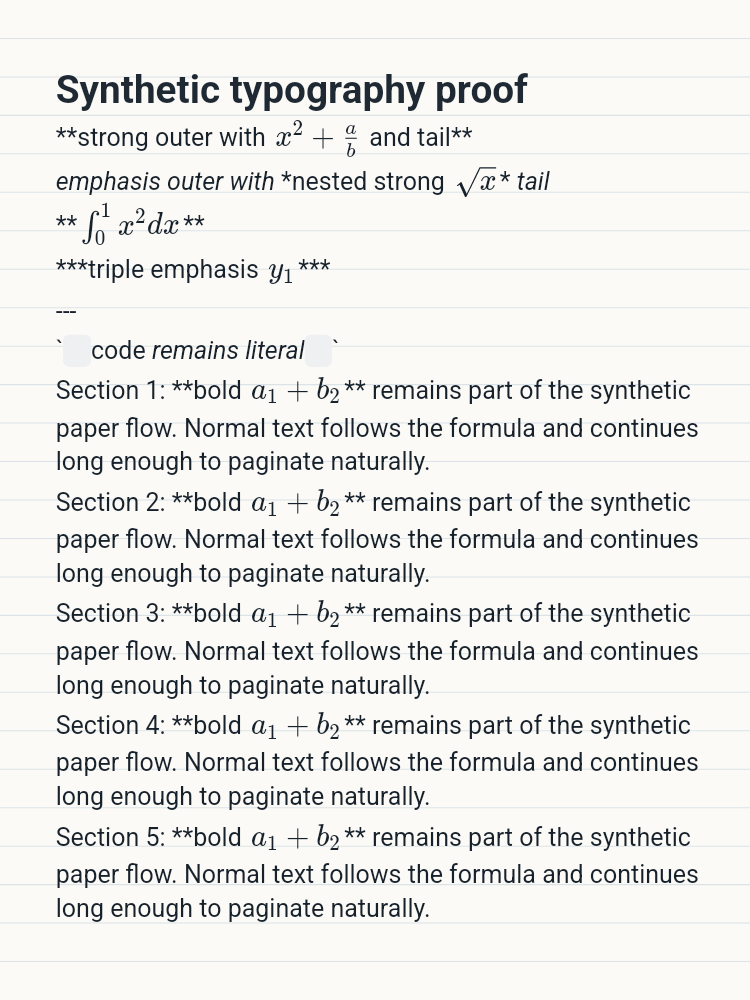 | 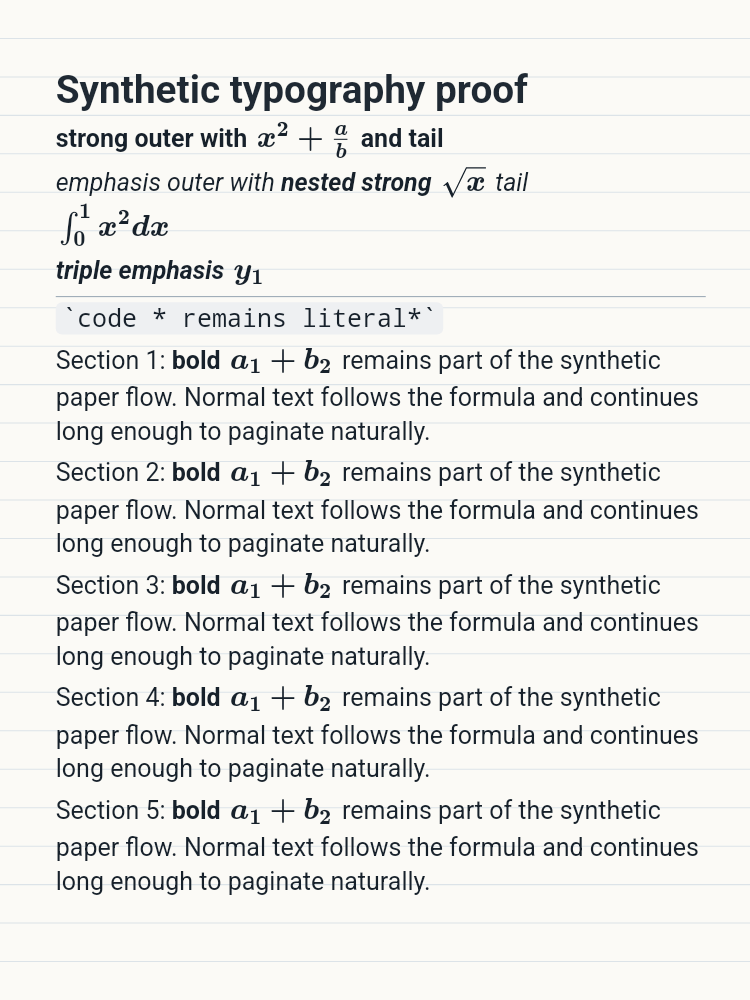 |

- **Android：**beta.38，versionCode 71；本节记录排版配置的历史版本。
- **iPad：**提供源码，不含签名 IPA。已添加的任务结果在重启 PadNote 后仍可从原任务直接打开对应笔记。
- **Windows：**连接助手沿用 beta.37，本版不包含新的桌面构建。

本版示例还包含经授权公开的真实平板手写页；桌面管理界面示意使用合成数据。演示二维码指向 `demo.invalid`。

## 从源码构建

Android 需要 JDK 17、Android SDK Platform 35 和 Build Tools 35.0.0：

```sh
cd android
./gradlew :app:testDebugUnitTest :app:assembleDebug
```

Windows 连接助手的源码与构建前提见[`Windows 安装说明`](desktop/connection-assistant/windows-setup/README-WINDOWS.md)。

## 许可与反馈

Android 与 iPad 自研客户端采用 MIT；视频 Agent 子项目采用 Apache-2.0。第三方组件许可见 [`THIRD_PARTY_NOTICES.md`](THIRD_PARTY_NOTICES.md) 与 [`LICENSING.md`](LICENSING.md)。反馈时请提供版本、设备、步骤和界面提示；不要附上 API 密钥、配对令牌、密码或私人笔记。


## Beta 40：长文分页与连接检查

Android 的 Markdown profile 2 让长篇内容回到纸面时延续粗体、斜体、代码、数学公式和链接等样式，并按词边界分页。排版依据可见内容测量，减少标记语法造成的空白；稳定后的文字布局也会纳入 PDF 页面余量检查。旧笔记不会自动切换到新排版；先预览，再由你确认切换。

电脑助手会分别说明“检查超时”和“已连接但服务没有返回 HTTP 响应”，并提示检查本机 API 状态或日志。同一配置并发检查时共用一次 Gateway 启动。

[Beta 40 功能与验证范围](BETA40_TESTING.md) · [GitHub Releases](https://github.com/shiyan688/padnote/releases)
